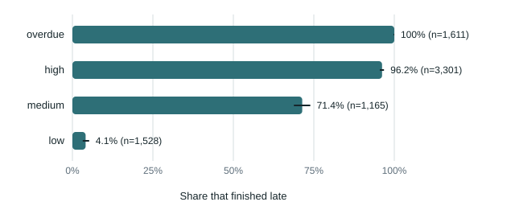

# Are the predictions honest? Calibration of the risk levels and the feasibility ranges

**Short answer.** The risk levels are well calibrated and rank orders far better than a naive rule: orders labelled *high* finished
late 96% of the time, *low* 4%, and the model's expected lateness separates late from on-time orders with an AUC of 0.98, against
0.67 for "the sooner it is due, the likelier it is late". The feasibility ranges were not as good as they looked. The earlier check
(14 of 14 inside the range) was too small: on 180 test orders the real finish fell inside the chat's range only **about 7 times in 10**.
The range is now widened by 3 working days at each end, a width learned on half of the simulated futures and tested on the other half,
where it held **94%** of real finishes. The widened range is still narrower than a naive one that holds half as often.

## Why this needed measuring

Two earlier numbers looked good and could both be flattering. High-risk orders were late 93% of the time, but in the provided data
nearly every order is late, so "high" is right by default. And the real finish fell inside the feasibility range 14 times out of 14,
but a range wide enough contains everything, and 14 cases cannot tell 95% from 75%. A probability-style claim needs two checks:
**calibration** (when it says X, does X happen at the stated rate?) and **sharpness or discrimination** (is it more informative than
a naive answer?).

## Method

* **Futures.** The simulator (`simulation/simulate.py`) rolled forward from 1 April with 30 different random seeds and no planted
  events, 400 days each. Mornings from day 0 to day 110 are judged, so the factory goes from badly behind (almost everything late) to
  caught up (most things on time) and every risk level occurs.
* **Risk levels.** Each order's level on each morning, against whether it really finished late in that future. Overdue orders are
  left out of the discrimination measure because they are late by definition.
* **Feasibility.** On 5 mornings in 12 other futures, 3 test orders each (400 to 1,500 pieces, due 14 to 70 days out). The range is
  computed by **the chat's own JavaScript tool, run in the real page** on that morning's briefing; then the same order is injected into
  the same future as a real order and its real finish recorded.
* **Baseline range.** The 10th to 90th percentile of how many working days orders that finished in the previous 60 days took.
* **Widening (split-conformal).** The first 6 futures give the distribution of how far real finishes fall outside the range; the
  smallest widening that would have covered 90% of them is applied to the other 6 futures, which were not used to choose it.

Reproduce: `python -m analysis.calibration` (about a minute; it needs Playwright for the chat's tool). A test
(`tests/test_calibration.py`) re-renders the tables below from the saved results and checks the chat uses the widening the study chose.

## Results

<!-- calibration:start (generated by analysis/calibration.py from analysis/results/calibration.json) -->

### Risk levels: what share actually finished late

7,605 order-mornings: 3,503 orders in 30 simulated futures, judged on mornings 0, 10, 20, 30, 40, 50, 60, 75, 90, 110 days after 1 April.

| Level | Order-mornings | Finished late | 95% interval |
|---|---|---|---|
| overdue | 1,611 | 100% | 99.8 to 100% |
| high | 3,301 | 96.2% | 95.5 to 96.8% |
| medium | 1,165 | 71.4% | 68.8 to 73.9% |
| low | 1,528 | 4.1% | 3.2 to 5.2% |

Discrimination, overdue orders left out (67.9% of the rest finished late): AUC **0.982** for the model's expected lateness, against **0.666** for the naive rule "the sooner it is due, the likelier it is late". 0.5 is a coin toss, 1.0 is perfect.

| Confidence label | Order-mornings | Late-or-not call right |
|---|---|---|
| high | 3,150 | 99.7% |
| medium | 2,141 | 89% |
| low | 703 | 60.5% |

Expected finish date against the real one (positive = later than expected):

| Made this far ahead (working days) | Orders | Mean error | Mean absolute error | Within 2 working days |
|---|---|---|---|---|
| up to 10 | 3,151 | -1 | 1.1 | 94% |
| 11 to 25 | 3,722 | -1.3 | 1.6 | 84.4% |
| over 25 | 732 | -1.8 | 2.4 | 60.9% |

### Feasibility ranges: right, and how wide

180 test orders injected into 12 simulated futures on mornings 0, 20, 40, 60, 90; 180 finished within the 400-day horizon; 0 ranges had no cautious end (the chat said it might not finish within 200 working days if new orders keep going ahead).

| Range | Cases | Real finish inside | Median width (working days) |
|---|---|---|---|
| The chat's range, best case to cautious case | 180 | 124 (68.9%; 95% 61.8 to 75.2%) | 11 |
| Naive: 10th to 90th percentile of recent order lead times | 180 | 92 (51.1%) | 20 |

Outside the chat's range: 29 finished before the best case, 27 after the cautious case. The median range is 37% of the real time taken; inside the range, the real finish sits at 0.51 of the way from best to cautious (0 = best case).

Widening the range so it covers what it claims (split-conformal: learned on half of the futures, tested on the other half):

| Target coverage | Widen each end by (working days) | Real finish inside, held-out half | Median width (working days) |
|---|---|---|---|
| unwidened (before) | 0 | 73.3% of 90 | 9.5 |
| 80% | 2 | 90% of 90 | 13.5 |
| 90% | 3 | 94.4% of 90 | 15.5 |

The chat now shows the range widened by 3 working days at each end. On all 180 cases (half of them used to choose the 3) the real finish is inside 93.3% of the time, median width 17 working days; the held-out figure above is the one to quote.

| Verdict given | Cases | Finished by the date | 95% interval |
|---|---|---|---|
| Likely feasible | 66 | 100% | 94.5 to 100% |
| Feasible but tight | 29 | 86.2% | 69.4 to 94.5% |
| Possible only if prioritised | 63 | 54% | 41.8 to 65.7% |
| Unlikely | 22 | 22.7% | 10.1 to 43.4% |

<!-- calibration:end -->

## What this changes

* **The chat's feasibility range is now widened by 3 working days at each end** (`RANGE_WIDEN` in `simulation/chat.js`), and the
  assumptions list says why. The verdict ("likely", "tight", "only if prioritised", "unlikely") still uses the unwidened estimates:
  the verdicts were already well ordered (100% of "likely" orders finished on time, 23% of "unlikely" ones).
* **The risk levels are left as they are.** "Medium" is the honest middle: 71% of medium orders finished late, so it means "more
  likely late than not, but not certain", which is what the page says.
* **The confidence label earns its place.** When the label is "high", the late-or-not call was right 99.7% of the time; "low", 61%.
  The page shows it beside every level.
* **The finish date drifts with distance.** Made 10 working days ahead, the expected date was within 2 days 94% of the time; made more
  than 25 days ahead, 61%. It leans early (finishes come about 1 to 2 days before the expected date), consistent with the engine's
  cautious assumption that partly done work starts from zero.

## Limits

* **The simulator is not a real factory**, and it schedules earliest-due-first like the projection engine, so this is the best case.
  On real data the levels would be less sharp.
* **Order-mornings are not independent.** The same order is judged on several mornings of the same future; the 95% intervals treat them
  as independent and are therefore too narrow. The distinct-order count is given so the reader can judge.
* **The widening was chosen on simulated futures.** Real finishes would scatter more (breakdowns, partial progress we cannot see), so 3
  days is a floor. With real outcomes the same script can re-learn it.
