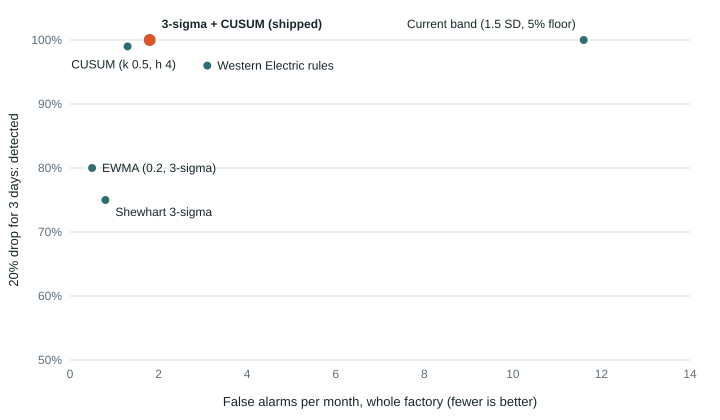

# When should a stage's output interrupt the manager? A statistical process control study

**Short answer.** The briefing used to raise a finding whenever a stage fell below its "normal band" (mean minus the larger of
1.5 SD and 5% of the mean, over the previous 8 same weekdays). Measured here, that rule would interrupt the manager about
**12 times a month with nothing wrong**, and it did fire 25 times on the real log before the one real event in it. The briefing
now raises a stage only when it passes a **Shewhart 3-sigma** limit (a sudden drop) or a lower **CUSUM** limit (a sustained smaller
drop), on the same baseline. That costs about **2 false alarms a month** and still catches every drop of 30% or more that lasts
3 days or longer, on average within the first day. What it gives up: short, small dips. A 20% drop for one day is caught about half
the time instead of 92%; a 10% dip for one day mostly goes unreported. That is the trade: one calm interruption a day was the
design principle (`docs/alert_triggers.md`), and an alarm the manager learns to ignore protects nothing.

The band still exists and still answers "is 800 pieces from assembly normal?" when the manager asks. Describing a day and
interrupting someone about it are different jobs, and now they have different rules.

## Why this needed measuring, not choosing

"Normal" was one explicit, inspectable rule, as the brief asks. But the brief also asks what earns an interruption, and the band's
width (1.5 SD) was chosen by reasoning. Standard practice in manufacturing quality control is different: a Shewhart chart at
3 sigma for large shifts, and CUSUM or EWMA for small sustained ones, with the false-alarm rate (in-control run length) traded
against detection delay. This study puts six rules on the same footing and measures both sides.

## Method

* **Same baseline for every rule**: the previous 8 same weekdays, Sundays closed, at least 3 samples, so only the decision rule differs.
* **Rules** (drops only, since a stage running high is not worth an interruption):
  current band; Shewhart 3-sigma (`x < mean - 3 SD`); Western Electric rules (1 point beyond 3 SD, 2 of 3 beyond 2 SD, 4 of 5 beyond
  1 SD, 8 in a row below the mean); EWMA of z-scores (lambda 0.2, 3-sigma limit); lower CUSUM of z-scores (k 0.5, h 4, restart after
  a signal); and 3-sigma OR CUSUM. The last row is computed by the shipped function `simulation.briefing.stage_alarm`, not a copy.
* **Truth.** In-control output is generated from the real log: each stage's weekday means, times residuals resampled from the real
  90 days in blocks of one working week (keeping the real tails and week-to-week correlation). The real assembly fall from 25 March
  is kept out of the residual pool and used as a real test case instead. A drop of known size (10 to 50%) and length (1, 3 or 8
  working days) is then planted at a random stage and day. Eight weeks of warm-up fill the baseline first.
* **Measures.** False alarms per 100 in-control stage-days, converted to a month for the whole factory (26 working days x 4 stages);
  for each planted drop, whether it was flagged from its first day to 5 working days after its last, and the delay.

Reproduce: `python -m analysis.spc_detection` (about six minutes; `--render` redraws this page from the saved results).
A test (`tests/test_spc_detection.py`) re-renders the tables below from the saved results and fails if they differ.

## Results

<!-- spc:start (generated by analysis/spc_detection.py from analysis/results/spc_detection.json) -->

### False alarms (no drop planted)

76,800 in-control stage-days, with noise resampled from the real log (day-to-day spread: Knitting 8.7%, Assembly 8.1%, Washing 8.7%, Packing 8.8%).

| Rule | False alarms per 100 stage-days | False alarms per month, whole factory | Alarms on the real log before 25 March |
|---|---|---|---|
| Current band (1.5 SD, 5% floor) | 11.11 | 11.6 | 25 |
| Shewhart 3-sigma | 0.81 | 0.8 | 3 |
| Western Electric rules | 2.99 | 3.1 | 6 |
| EWMA (0.2, 3-sigma) | 0.51 | 0.5 | 1 |
| CUSUM (k 0.5, h 4) | 1.28 | 1.3 | 3 |
| 3-sigma + CUSUM (shipped) | 1.77 | 1.8 | 4 |

A month is 26 working days x 4 stages. The real log (2026-01-01 to 2026-03-31, 236 judged stage-days) has no ground truth before 25 March, so that column is alert volume, not accuracy.

### Detection of planted drops (detected % / mean delay in working days, 0 = flagged on the first day)

| Drop | Lasts | Current band (1.5 SD, 5% floor) | Shewhart 3-sigma | Western Electric rules | EWMA (0.2, 3-sigma) | CUSUM (k 0.5, h 4) | 3-sigma + CUSUM (shipped) |
|---|---|---|---|---|---|---|---|
| 50% | 1 d | 100% / 0 | 100% / 0 | 100% / 0 | 80% / 0.18 | 98% / 0.03 | 100% / 0 |
| 50% | 3 d | 100% / 0 | 100% / 0 | 100% / 0 | 100% / 0.24 | 100% / 0.01 | 100% / 0 |
| 50% | 8 d | 100% / 0 | 100% / 0 | 100% / 0 | 100% / 0.29 | 100% / 0.02 | 100% / 0 |
| 30% | 1 d | 100% / 0 | 74% / 0.07 | 80% / 0.11 | 32% / 0.57 | 60% / 0.45 | 80% / 0.17 |
| 30% | 3 d | 100% / 0 | 100% / 0.26 | 100% / 0.17 | 100% / 0.84 | 100% / 0.58 | 100% / 0.21 |
| 30% | 8 d | 100% / 0 | 100% / 0.41 | 100% / 0.27 | 100% / 0.94 | 100% / 0.56 | 100% / 0.26 |
| 20% | 1 d | 92% / 0.1 | 46% / 0.16 | 54% / 0.28 | 20% / 0.47 | 39% / 0.81 | 56% / 0.36 |
| 20% | 3 d | 100% / 0.18 | 75% / 0.61 | 96% / 0.78 | 80% / 1.33 | 99% / 1.16 | 100% / 0.84 |
| 20% | 8 d | 100% / 0.21 | 96% / 1.49 | 100% / 0.97 | 100% / 1.72 | 100% / 1.18 | 100% / 0.93 |
| 10% | 1 d | 66% / 0.94 | 11% / 1.18 | 22% / 1.39 | 8% / 1.87 | 18% / 1.35 | 23% / 1.41 |
| 10% | 3 d | 87% / 0.89 | 26% / 1.02 | 50% / 1.38 | 29% / 1.76 | 46% / 1.77 | 48% / 1.51 |
| 10% | 8 d | 98% / 1.15 | 49% / 3.29 | 86% / 2.99 | 74% / 4.15 | 87% / 3.29 | 88% / 3.08 |

200 runs per row, the stage and start day drawn at random. The briefing reads yesterday's data, so the manager hears about a drop one morning after the day it is flagged.

### The real event: assembly from 25 March

| Rule | Event days flagged | First flagged |
|---|---|---|
| Current band (1.5 SD, 5% floor) | 6 of 6 | 2026-03-25 |
| Shewhart 3-sigma | 6 of 6 | 2026-03-25 |
| Western Electric rules | 6 of 6 | 2026-03-25 |
| EWMA (0.2, 3-sigma) | 4 of 6 | 2026-03-26 |
| CUSUM (k 0.5, h 4) | 6 of 6 | 2026-03-25 |
| 3-sigma + CUSUM (shipped) | 6 of 6 | 2026-03-25 |

<!-- spc:end -->

## Reading it

* **The 1.5 SD band is a description, not an alarm.** It catches almost everything, including about 1 ordinary day in 9.
  On the real log it fired 25 times in under three months before anything was actually wrong.
* **3-sigma alone is quiet but slow on small drops.** Its false-alarm rate is 0.8 a month, not the textbook 0.13% per point,
  because the limits come from only 8 samples: the estimated SD is itself noisy. That is worth knowing whenever a control chart is
  built on a short history.
* **CUSUM is what recovers the small sustained drops.** A 10% drop lasting 8 days: 3-sigma finds 49%, CUSUM 87%, together 88%.
  Western Electric rules do as well on detection but cost 3 false alarms a month.
* **EWMA was the quietest but the slowest,** and it missed 2 of the 6 days of the real assembly event.
* **The real event**, assembly falling about 45% from 25 March, was flagged on its first day by every rule except EWMA.
* **In the demo** (15 simulated mornings), the change kept discovery at 5 of 5 planted events. One got slower: the continuation of
  the assembly slowdown on 1 to 3 April is now raised on 4 April instead of 2 April, because the fall itself was already reported on
  1 April and its baseline was still inflated by it. Stage findings with no planted event behind them went from 7 to 5; the ones left
  are 30 to 45% drops where the simulated stage ran out of work, which any rule would raise.

## Limits

* The process is generated from 90 days of one synthetic data set. Real output can have holidays, changeovers and heavier tails;
  the false-alarm rates here are a floor.
* Queues never run dry in the generator. A stage that runs out of work also shows a drop; the briefing adds "may be short of work"
  when the stage before it was also low.
* The parameters (3 sigma, k 0.5, h 4) are textbook defaults, not tuned to this data, so these results are not flattered by tuning.
  A real factory would pick h from the false-alarm rate its manager will tolerate.
